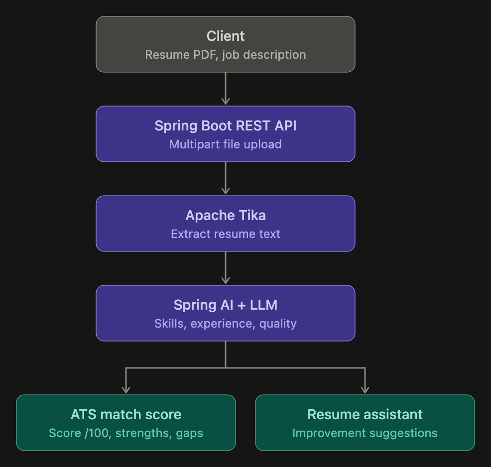

# AI-Powered ATS Resume Checker & Resume Assistant

**Technologies:** Java, Spring Boot, Spring AI, Apache Tika, REST APIs, PDF Parsing, LLM Integration

Developed an AI-powered resume analysis application that evaluates resumes against job descriptions, identifies skill gaps, and provides actionable recommendations to improve ATS compatibility.

**Key Features:**

- **ATS Score Analysis:** Evaluates how closely a candidate's resume matches a given job description and generates a compatibility score out of 100.
- **AI-Powered Resume Feedback:** Identifies strengths, missing skills, areas for improvement, and actionable suggestions to improve resume quality and job relevance.
- **PDF Resume Parsing:** Enables users to upload PDF resumes through multipart file uploads, extracts resume content using Apache Tika, and processes the extracted text using Spring AI and an LLM.
- **Interactive Resume Assistant:** Allows candidates to analyze their resumes and receive personalized guidance on improving content, highlighting relevant achievements, and aligning their resumes with job requirements.

**Diagram:**

